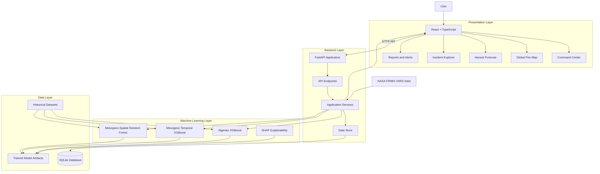
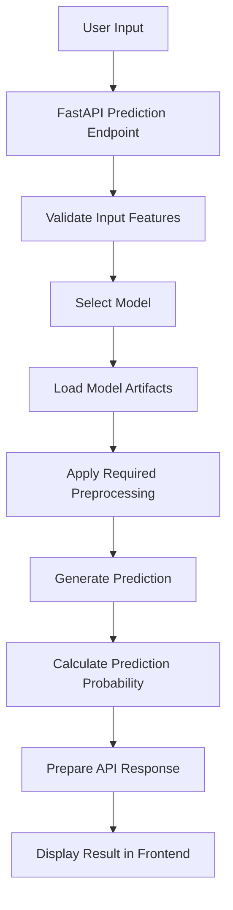

# PyraSight — System Architecture

## 1. Architecture Overview

PyraSight follows a frontend-backend architecture with a separate machine learning layer and persistent application storage.

The frontend provides the user interface, the backend manages application logic and API requests, machine learning services handle model inference, and SQLite stores application records.

The system is organized into the following major layers:

1. Presentation Layer
2. API and Backend Layer
3. Machine Learning Layer
4. Data and Persistence Layer
5. External Data Layer

## 2. High-Level Architecture



## 3. Frontend Architecture

### Technology
- React
- TypeScript
- Vite
- Tailwind CSS
- MapLibre GL JS

### Responsibilities

The frontend is responsible for:

- Rendering the application interface.
- Handling user interactions.
- Displaying dashboard statistics.
- Collecting prediction input features.
- Displaying machine learning prediction results.
- Rendering satellite thermal detections on an interactive map.
- Managing incident-related interactions.
- Displaying reports and alert information.

### Main Pages

| Page | Responsibility |
|---|---|
| Command Center | Dashboard overview and statistics |
| Hazard Forecast | Model-based fire-danger prediction |
| Global Fire Map | Geographic thermal-detection visualization |
| Incident Explorer | Incident management |
| Reports & Alerts | Report and alert-rule management |

### API Communication

The frontend communicates with the FastAPI backend through HTTP requests.

The Vite development server uses a proxy configuration to forward `/api` requests to the backend running on port 8000.

## 4. Backend Architecture

### Technology
- Python
- FastAPI
- Uvicorn
- Pydantic

### Responsibilities

The backend handles:

- API request processing.
- Request and response validation.
- Machine learning model loading.
- Prediction execution.
- FIRMS detection access.
- Incident operations.
- Report generation.
- Alert management.
- SQLite persistence.

### Main Backend Components

| Component | Responsibility |
|---|---|
| API Endpoints | Handle incoming HTTP requests |
| Schemas | Validate and structure data |
| Model Service | Load models and execute inference |
| Data Store | Manage application records |
| Configuration | Store application settings |
| Main Application | Initialize and configure FastAPI |

## 5. Machine Learning Architecture

PyraSight uses separate trained model artifacts for different classification tasks and evaluation strategies.

### 5.1 Algerian Model

- Algorithm: XGBoost.
- Purpose: Fire versus no-fire classification.
- Dataset: Algerian Forest Fires dataset.
- Input: Environmental and fire-weather features.
- Output: Predicted class and probability.

### 5.2 Mesogeos Temporal Model

- Algorithm: XGBoost.
- Purpose: Fire-danger classification.
- Evaluation strategy: Chronological group-aware split.
- Preprocessing: Training-fitted median imputation and scaling artifacts.

### 5.3 Mesogeos Spatial Model

- Algorithm: Random Forest.
- Purpose: Fire-danger classification.
- Evaluation strategy: Spatial block-based split with a 25 km training buffer.

### 5.4 Inference Workflow



The Mesogeos temporal model uses its saved imputer during inference to maintain consistency with the training pipeline.

## 6. Database Architecture

### Database Technology

SQLite is used for local application persistence.

### Database Location

```text
backend/data/pyrasight.db
```

### Persistence Responsibilities

The SQLite-backed data store maintains application records such as:

- Incidents.
- Prediction history.
- Alert rules.
- Reports.

Persistence was verified by restarting the backend and checking whether existing records remained available.

The database file is runtime data and should not be committed to the public source-code repository.

## 7. Geospatial Architecture

### Technology

- MapLibre GL JS
- GeoJSON
- NASA FIRMS VIIRS thermal-detection records

### Data Flow

1. Frontend requests detection records from the backend.
2. Backend returns detection data.
3. Frontend validates latitude and longitude.
4. Valid records are converted into GeoJSON features.
5. Features are added to the MapLibre GeoJSON source.
6. A circle layer renders the detection points.
7. Marker colors represent confidence categories.
8. Selecting a marker displays its observation details.

### Confidence Visualization

| Confidence | Marker Color |
|---|---|
| High | Red |
| Nominal | Orange |
| Low | Yellow |

MapLibre is also used to automatically fit the map to the returned detection coordinates.

## 8. External Data Integration

NASA FIRMS VIIRS thermal-detection records are used for geospatial awareness.

The backend exposes detection records to the frontend, which displays them on the Global Fire Map.

Thermal anomalies should not automatically be interpreted as confirmed wildfires.

The project also uses historical datasets for model training and evaluation. These datasets are separate from the FIRMS detection visualization workflow.

## 9. Application Startup Sequence

The normal local development startup sequence is:

### Backend

```powershell
cd backend

python -m uvicorn app.main:app --reload --port 8000
```

During startup, the application initializes its data store, loads available model artifacts, and loads FIRMS detection records.

### Frontend

```powershell
cd frontend

npm run dev
```

The frontend communicates with the backend through the configured development proxy.

## 10. Deployment Architecture Considerations

A production deployment should provide:

- A hosted frontend.
- A separately hosted FastAPI backend.
- Persistent database storage.
- Secure environment-variable configuration.
- Reliable access to model artifacts.
- Correct API base URL and CORS configuration.
- Appropriate logging and error handling.

The local SQLite setup is suitable for the current development workflow. A production environment with multiple concurrent application instances may require a more suitable managed database.

Deployment architecture remains subject to implementation and testing.

## 11. Architecture Limitations

- The current application is a research and academic prototype.
- Model predictions depend on historical training data and supplied environmental features.
- Satellite thermal detections are not confirmed wildfire records.
- Temporal and spatial evaluation protocols have different assumptions.
- No operational real-time forecasting capability has been established.
- Production deployment and scalability have not yet been verified.

---

**End of Architecture Documentation**